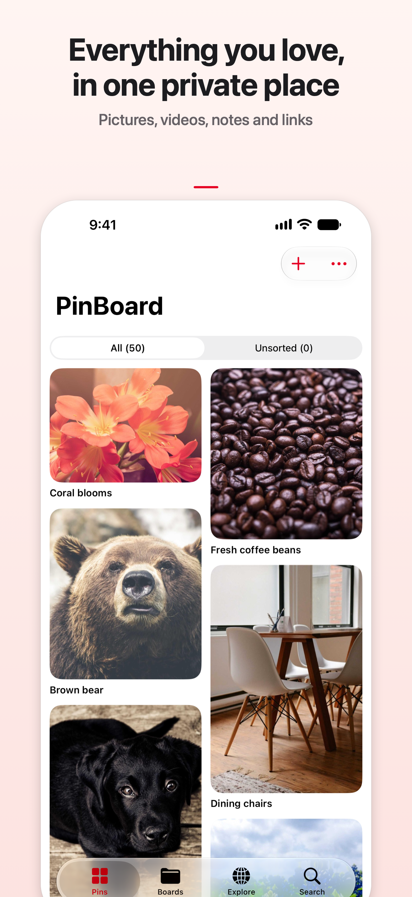
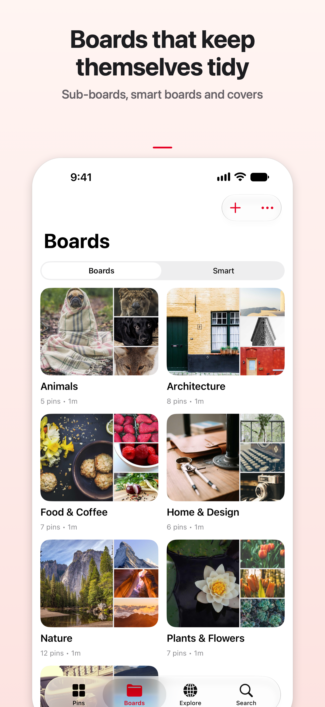
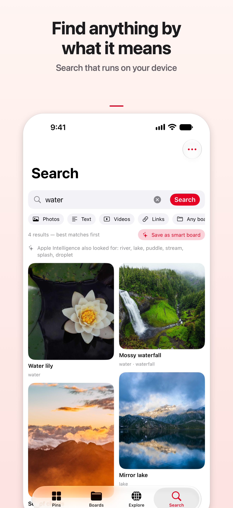
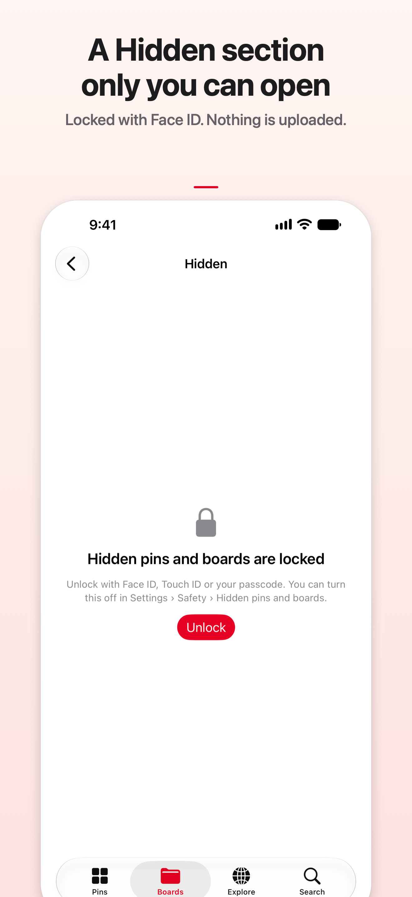

# PinBoard - Pins Your Way

**A private place for the pictures, videos, notes and links you love.**

PinBoard is a personal inspiration library for iPhone and iPad, and it also runs on Macs with Apple silicon and on Apple Vision Pro. Save pictures, videos, GIFs, notes, quotes and links as pins, gather them on boards, and find anything again by what it shows or says.

> **Get PinBoard:** coming soon to TestFlight and the App Store. *(Link to follow.)*

## Private by design

Privacy is the whole point of PinBoard. **Nothing leaves your device unless you turn it on.**

- No account, no server, no ads, no analytics and no tracking. The developer never sees your library.
- Your library lives on your device. iCloud sync is optional and uses *your own* iCloud account.
- The AI that tags, titles and sorts your pins runs on your device.
- PinBoard goes online only when you search the web, save or open a link, or switch on iCloud sync or the optional Cloud AI (which uses your own key and asks first).
- **Offline mode** switches all of that off at once.
- The code is right here, so anyone can check how it treats your data.

Read the full [privacy policy](docs/privacy.md).

## Screenshots

<p>
  
  
  
  
</p>

*Demo photos from Unsplash; see [photo credits](AppStore/photo-credits.txt).*

## Features

**Save from anywhere**
- Share to PinBoard from Photos, Safari, Files, Messages and other apps, and choose a board right in the share sheet.
- Photos and videos from your library, the camera or Files, and text pins for quotes, ideas and lists.
- Links that read the page for you: an article's text, writer and date, or a video's title and details.
- Highlight passages in a saved article and keep them as quote pins. Drag and drop on iPad.

**AI that runs on your device**
- Every picture is tagged automatically: what's in it, its colours and any words in it.
- Speech in your videos is written down on the device, so you can search for what was said.
- Untitled pins get a title, "Sort into boards" suggests where new pins belong, and look-alikes are spotted before you save a picture twice.

**Boards that stay tidy**
- Boards and sub-boards to any depth, with favourites and covers.
- Smart boards that fill themselves from a saved search, and an Unsorted view for pins still waiting for a board.

**Find it again**
- Search by words, tags, colours, the text in a picture or what a video says. Filter by kind, board and date.
- "More like this" on every pin.

**A Hidden side only you can open**
- Keep private pins and boards behind Face ID, Touch ID or your passcode.
- Hidden pins never appear in your feed, search, suggestions, widgets or the share sheet, and the AI leaves them alone unless you choose otherwise.

**And more**
- Photo, Photo Grid and Quote widgets for your Home Screen.
- Full-screen viewing with zoom, a video player with skip buttons, and crop, rotate and flip.
- Search openly licensed pictures from Wikimedia Commons, Openverse, Pexels, Pixabay or Unsplash.
- Separate profiles, optional iCloud sync between your devices, and export everything as folders or a zip whenever you like.

New to PinBoard? The [user guide](docs/user-guide.md) walks through everything.

## Build it from source

PinBoard is a SwiftUI app written in Swift 6 (strict concurrency) for iOS 17 and later. It has no third-party dependencies.

**You need** a Mac with **Xcode 26 or later** (the app icons are Icon Composer files) and Python 3, which comes with macOS.

### The folders

| Folder | What's in it |
|---|---|
| `PinBoard/` | The app's source code: every Swift file of the app. |
| `Xcode/` | The Xcode project, the widget extension (`PinBoardWidgets/`), the share extension (`PinBoardShare/`), the app icons and settings (`App/`), and the build scripts. |
| `docs/` | The web pages (privacy policy, support, user guide) and the full feature and design list. |
| `AppStore/` | App Store text, screenshots, icon drawings and review notes. |

### Steps

1. **Generate the Xcode project.** The project file is made by a script, so it always lists every Swift file in `PinBoard/`:

   ```bash
   cd Xcode && python3 make-project.py
   ```

   Run it again whenever you add or remove a Swift file.

2. **Try a build without signing** (no Apple account needed):

   ```bash
   xcodebuild -project PinBoard.xcodeproj -scheme PinBoard -destination 'generic/platform=iOS Simulator' CODE_SIGNING_ALLOWED=NO build
   ```

   Or open `Xcode/PinBoard.xcodeproj` in Xcode, pick a simulator and press Run.

3. **To run it on your own device, use your own team and identifiers.** The identifiers in this repository belong to the official app, so Apple won't let anyone else sign with them. Choose your own reverse-domain name (for example `com.example.pinboard`) and change it in these places:

   | What | Where |
   |---|---|
   | Your team ID | `DEVELOPMENT_TEAM` in `Xcode/make-project.py`, `teamID` in `Xcode/ExportOptions.plist`, and the team prefix in `Xcode/PinBoard.entitlements` |
   | Bundle IDs (app, `.widgets`, `.share`) | `PRODUCT_BUNDLE_IDENTIFIER` in `Xcode/make-project.py`, and `CFBundleURLName` in `Xcode/PinBoard-Info.plist` |
   | App Group | `Xcode/PinBoard.entitlements`, `Xcode/PinBoardWidgets.entitlements`, `Xcode/PinBoardShare.entitlements`, and `appGroup` in `PinBoard/ShareShared.swift` and `PinBoard/WidgetShared.swift` |
   | iCloud container | `Xcode/PinBoard.entitlements` |

   Then run `python3 make-project.py` again. On [developer.apple.com](https://developer.apple.com/account/resources/identifiers/list), give all three App IDs your App Group, and the app's ID iCloud (iCloud Documents) with your container. Xcode's automatic signing does the rest.

`Xcode/upload-testflight.sh <build number>` archives the app and uploads it to TestFlight; it is only useful with your own App Store Connect app.

## Questions or bugs?

Open an issue on **[GitHub Issues](https://github.com/silent-diffusion/PinBoard/issues)**. Please search the existing issues first, and don't post pictures or details from your library that you want to keep private: issues are public. The [support page](docs/support.md) answers the most common questions.

## License

PinBoard is free and open source under the [MIT License](LICENSE). Copyright (c) 2026 silent-diffusion.
